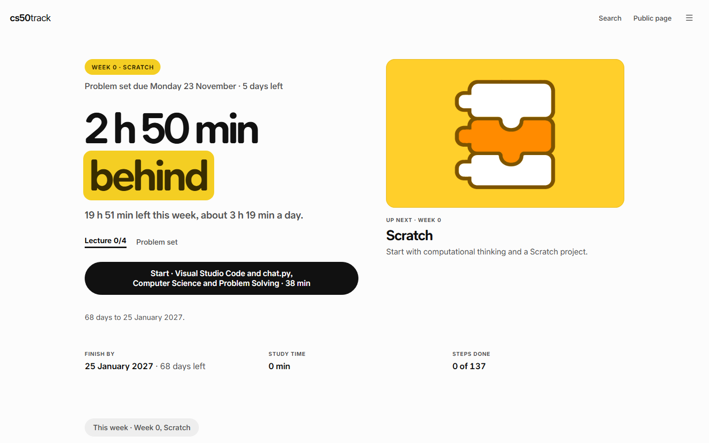
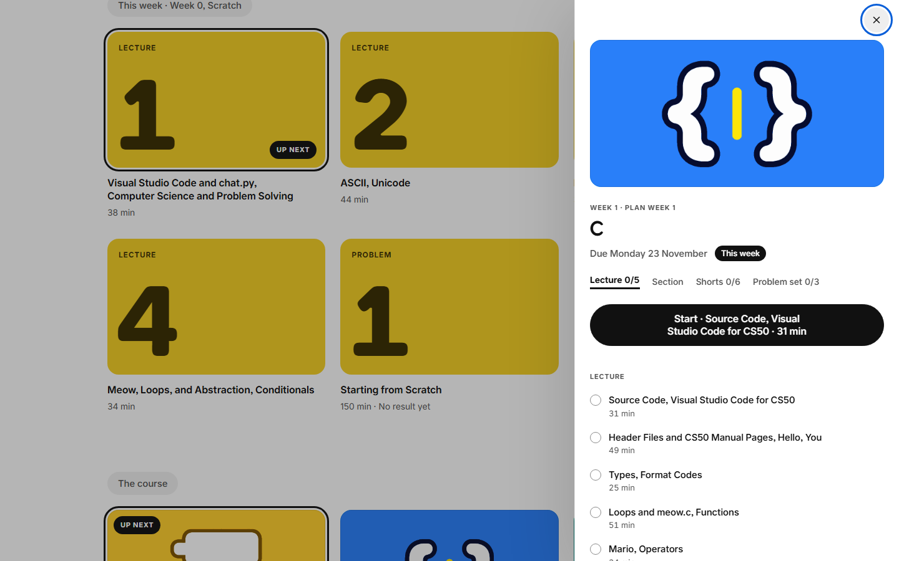
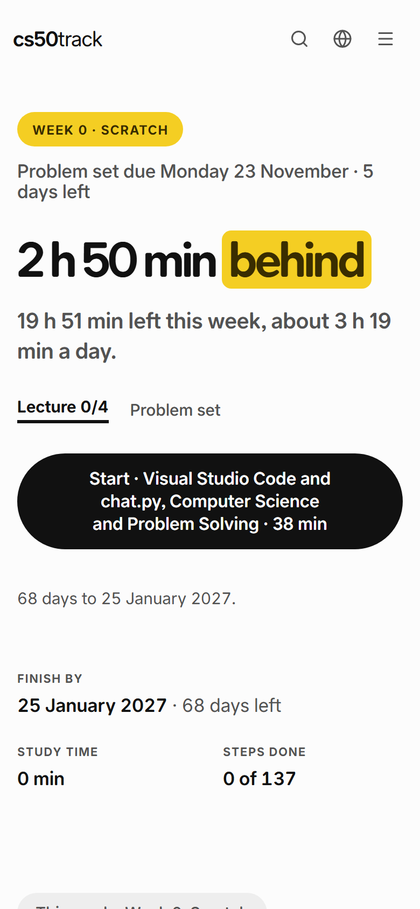
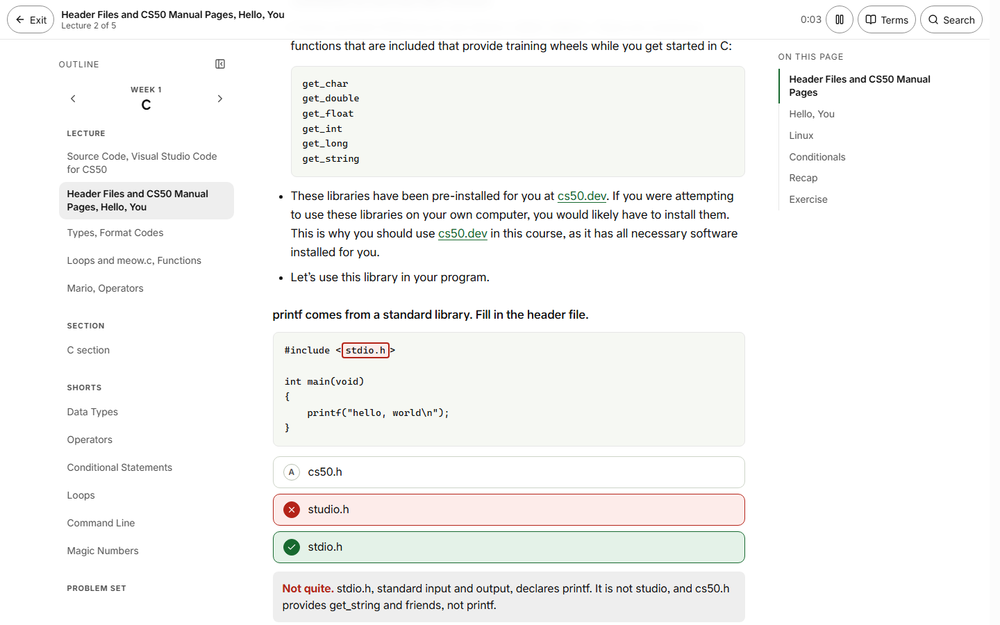

<h1 align="center">cs50track</h1>

<p align="center">
  A focused, solo way to finish Harvard's CS50x in ten weeks.<br />
  One lesson page per lecture part, a weekly pace number, and a permanent record of every week.
</p>

<p align="center">
  <a href="https://cs50track.dhaf.in"></a>
  <a href="https://cs50track.dhaf.in/p"></a>
  
</p>

<p align="center">
  
  
  
  
  
  
  
</p>

<p align="center">
  
</p>

> The progress badge above is served by the app itself. It reads **CS50x: private** until the owner switches the public page on, then it shows your progress.

## Why this exists

CS50x is free and excellent, and it has no one holding you to it. Nobody checks in, nobody notices a missed week, and the official site spreads a lecture across notes, a video, a section, shorts and a problem set. cs50track is a private study app for one person that does three things:

1. **Teaches the way the course flows.** Lecture, then section, then shorts, then the problem set, using CS50's own material. Each lecture part is one scrolling page with a video, the notes, a question every few paragraphs and an exercise at the bottom.
2. **Keeps one number in front of you.** How far ahead or behind you are this week, and what a day has to look like to catch up.
3. **Keeps the record.** Each week is marked on time, late or missed and stays that way. A public page and badge show it, so someone can look.

It is built for one learner. It is not a platform, and there is no sign-up.

## What you get

### One course page

Home and Track are a single page. The top shows the week, the deadline, how far ahead or behind you are, the next step and a Start button. Below that are the steps of the current week and a grid of all eleven units plus the project, each with its own sticker colour and a generated thumbnail.

On a phone it is the same page in one column. A unit card opens a **week sheet** over the page, so you never leave it. The sheet lists every step grouped by stage and takes problem-set results.

<p align="center">
  
</p>

<p align="center">
  
</p>

### Lessons that teach

A lesson is one page with a reading column, a sidebar outline and an "On this page" list that follows your place.

- A **video** of the lecture part with CS50's own chapters, speed buttons and the keyboard shortcuts from CS50's player (space or `k`, `j` and `l`, comma and period for frames, `<` and `>` for speed, `c`, `m`, `f`).
- CS50's **lecture notes**, split at each heading, with a "play from here" time badge on every heading.
- An **interaction every couple of paragraphs**: predict the output, trace a program line by line, compare two versions, fill a blank, or play with a small demo of binary, loops, search, memory, the stack, SQL or HTTP.
- A **recap**, an **exercise** with hints and a reveal-last solution, and a short **recall** set that comes back on a spaced schedule (1, 3, 7, 14 and 30 days).
- Mermaid diagrams that render, loaded only when a page has one.

<p align="center">
  
</p>

### Accountability for one person

- **A pace number.** Minutes of work left this week against days left, shown as "ahead" or "behind" and what a day needs to be.
- **A fixed end date.** 25 January 2027, ten calendar weeks from the start date. Week 0 shares the first plan week and the final project shares the last.
- **A weekly record.** Every week ends as on time, late or missed. It does not reset.
- **A public page and badge.** Optional, off by default. It shows the week, the record and a name you choose. Results are self-recorded, and the page says so.
- **Short on time?** A ten-minute recall run reviews what is due without a full session.

### The course content

- **11 units** (Week 0 to Week 10) and the **final project**: 137 steps in all, made of 48 lecture parts, 9 sections, 46 shorts and the problem sets.
- Each lecture is cut into parts of about 30 minutes, with times matched to CS50's own chapters (101 of 157 headings land on an exact chapter, the rest are matched from subtitles).
- More than 600 questions across predict, blank, compare, recap and recall items, each with an explanation. The right answer is not always option A: options are shuffled by a fixed seed, and a test fails if one position is too common.
- Imported CS50x 2026 materials: 708 documents and 205 downloadable files, searchable from inside the app.

## How it is built

| Layer | What it uses |
| --- | --- |
| App | TanStack Start and Router, React 19, Vite 8, TypeScript, plain CSS |
| Type | [Allo](https://allo.joshpuckett.me/) variable font (SIL OFL), self-hosted |
| Server | One Cloudflare Worker for the auth and state API, Cloudflare D1 for storage |
| Login | A single-use email link, restricted to the owner's address, sent with Cloudflare Email Sending |
| Content | `public/course/2026` (imported CS50 corpus) and `src/content/week-N.ts` (lesson content) |
| Tests | Vitest for the domain, Miniflare D1 for the API, Playwright for the screens |

The whole study state is one schema-validated snapshot with a revision check, so a stale write from another device is rejected instead of overwriting newer progress. The Worker serves the public page and badge from a summary that contains no private notes.

A longer write-up is in [ARCHITECTURE.md](ARCHITECTURE.md). The product behaviour is specified in [workflows/](workflows/).

### Project layout

```text
src/
  content/   Lesson content for each week, plus tests that tie it to the real lecture notes
  lib/       Domain: flow, pace, weekly record, recall spacing, sessions, public summary
  server/    Worker: auth, state API, public endpoints
  ui/        Course page, week sheet, lesson session, player, interactions, public page
scripts/     Course import, flow builder, production build and deploy guard
public/      Imported CS50 corpus, thumbnails, fonts
migrations/  D1 schema
tests/       Playwright specs
```

## Run it locally

You need Node 24 or later.

> **Private package.** The UI depends on `@agentic-ui/design-system`, which comes from a private registry. `.npmrc` reads the token from `AGENTIC_NPM_TOKEN` and contains no secret. Without a token, `npm ci` fails for that one package. If you fork this, either set a token you have access to or remove that dependency, which is imported in `src/routes/__root.tsx`.

```powershell
npm ci
Copy-Item .dev.vars.example .dev.vars
npm run db:local
npm run dev
```

Open http://127.0.0.1:5173. In development mode on a loopback host the app opens straight to the dashboard with a local demo account. Production always requires the email link.

To try the email-link flow locally, set `LOCAL_AUTH_BYPASS=false` in `.dev.vars`, restart, request a link for `student@localhost.test`, and open the captured link.

### Scripts

| Command | What it does |
| --- | --- |
| `npm run dev` | Start the dev server on port 5173 |
| `npm run check` | Build, type-check and run the unit tests |
| `npm run test:e2e` | Run the Playwright suite (see the warning below) |
| `npm run course:import` | Rebuild `public/course/2026` from the local download cache |
| `npm run course:refresh` | Fetch fresh CS50 pages, then import |
| `npm run course:flow` | Regenerate `flow.json` and the chapter list from the imported course |
| `npm run db:local` | Apply D1 migrations to the local database |
| `npm run deploy:check` | Production build plus a dry-run upload |
| `npm run deploy` | Build for production and publish |

## Test it

```powershell
npm run check
npx playwright install chromium
npm run test:e2e
```

The browser tests need the dev server and `.dev.vars`. **They reset the local demo account's study state, so never point them at production** and expect them to wipe local progress. Run Playwright specs one at a time if you run several workers against one server, since they share one local database.

Content has its own guard. `src/content/content.test.ts` fails if a lecture part, heading or short has no matching content, if an answer index is out of range, or if the correct answer sits in one position too often. After refreshing the course, run `npm run course:flow` and then `npm test`.

## Deploy

The production setup targets Cloudflare Workers with a custom domain, a D1 database and Email Sending. `scripts/production.mjs` refuses to deploy if the configured origin does not match.

1. Sign in with `npx wrangler login`.
2. Create a D1 database and put its ID under `env.production` in `wrangler.jsonc`.
3. Set `APP_ORIGIN`, `OWNER_EMAIL` and `EMAIL_FROM` under `env.production.vars`.
4. Enable Email Sending for your sender domain and check it with `npx wrangler email sending settings <domain>`.
5. Apply the schema: `npm run db:remote`.
6. Run `npm run deploy:check`, then `npm run deploy`.
7. Request a login link at the live address and confirm the email arrives, the link works once, and a saved change survives a refresh.

Production disables the `workers.dev` and preview URLs. Keep `.dev.vars`, npm credentials and Cloudflare tokens out of version control. If you build in CI, set `AGENTIC_NPM_TOKEN` as a build secret.

## Known limits

These are real, and they are listed so they do not surprise you.

- **The record is self-reported.** Start date and problem-set attempts can be edited, so the public page is a statement of honesty, not proof. Harvard's gradebook confirms completion.
- **Only one learner.** Login is locked to a single owner email by design.
- **Per-day pace can look large** when you are far behind, because it divides what is left by the days that remain.
- **Mermaid is heavy** (about 1 MB), so it loads only on pages that have a diagram.
- **Some narrow layouts are tight**: a lone card at 768px and a squeezed session title at 320px.
- **Production email delivery depends on your Cloudflare account** and its recipient policy, so test it once after deploying.

## Credits and licences

- **CS50x 2026** lecture notes, problem sets, sections and shorts are by David J. Malan and the CS50 team at Harvard University. They are imported and reformatted here under [CC BY-NC-SA 4.0](https://cs50.harvard.edu/x/2026/license/). Changes are navigation, presentation and links only, and no endorsement is implied. Attribution is recorded in [`public/course/2026/ATTRIBUTION.md`](public/course/2026/ATTRIBUTION.md). Videos and audio stream from CS50's own hosts and are not copied. Because of the NonCommercial and ShareAlike terms, treat this repository's CS50 content accordingly.
- **Allo** by Josh Puckett is used under the SIL Open Font License ([licence](public/fonts/Allo-LICENSE.txt)).
- **animations.dev** and **Allo's site** were design references for lesson flow, layout and tone. No paid lesson text, code or video was copied.
- Lesson interactions, questions, exercises, recall sets, demos and unit thumbnails are original to this project.

The application code in this repository has no separate open-source licence yet. Until one is added, all rights to it are reserved.
